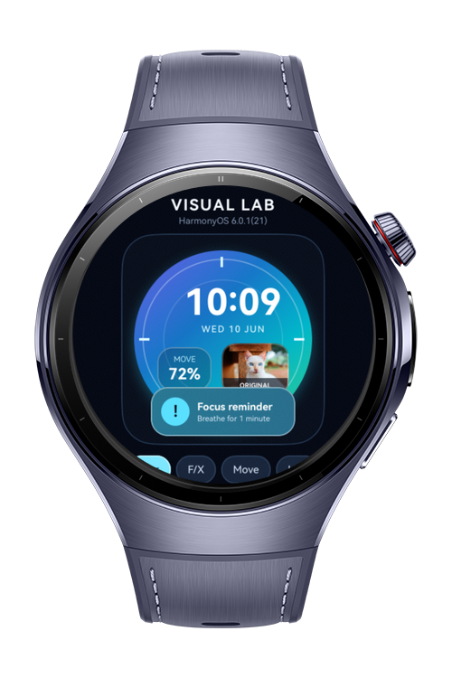
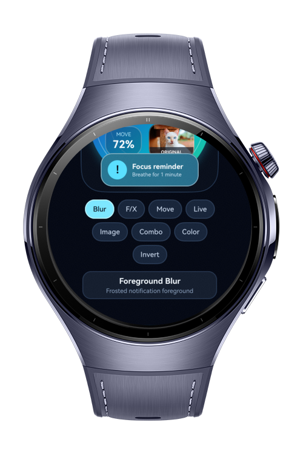
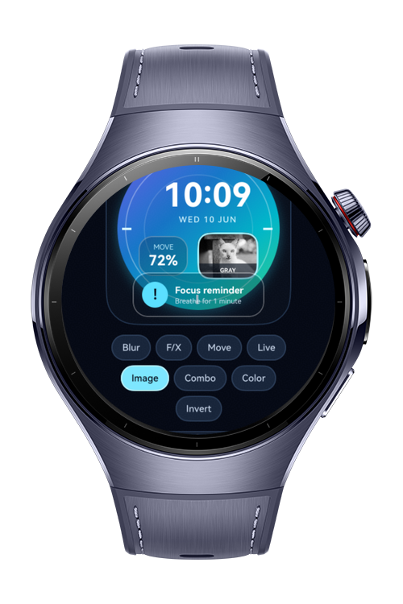
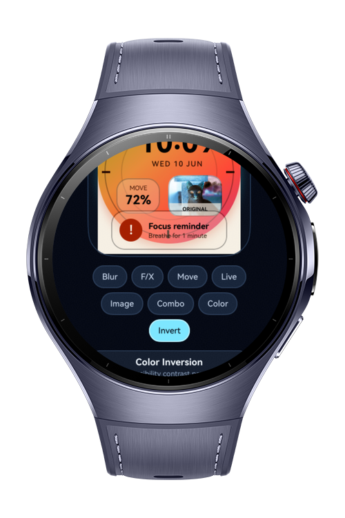

> **Note:** To access all shared projects, get information about environment setup, and view other guides, please visit [Explore-In-HMOS Index](https://github.com/Explore-In-HMOS/hmos-index).

# How to Build Visual Effects

This app is a wearable visual effects showcase that uses Foreground Blur for applying Gaussian blur to foreground content(frosted glass notification cards). Foreground Effect for combining blur with saturation and brightness adjustments, Motion Blur for stimulating directional motion blur during swipe animations, Visual Effect for applying real-time visual effects to component rendering, Image Effect for processing image display with filters(greyscale, sepia, contrast), Special Effect Drawing Combination for composting multiple effects into a single render pass, Color Gradient for multi-stop gradient backgrounds, and Color Inversion for accessibility-focused inverted color display. Each effect is demonstrated on a watch face with complication card.

# Preview

<div>
  
  
  
  
</div>

# Use Cases

- Demonstrate `foregroundBlurStyle` on a frosted-glass notification card without hiding the card content.
- Combine `foregroundEffect` with saturation and brightness attributes for a richer foreground surface.
- Show `motionBlur` during a swipe animation and reset the blur radius when the animation finishes.
- Attach `visualEffect` and a live foreground filter to component rendering.
- Process a decoded `PixelMap` with `effectKit` image filters for grayscale, sepia, and contrast.
- Combine special drawing effects with `useEffect`, `backgroundEffect`, and `renderGroup`.
- Render a multi-stop `linearGradient` watch background.
- Toggle `invert` and `allowForceDark` for accessibility-focused color inversion.

# Technology
## Stack

- **Languages**: ArkTS, ArkUI
- **Frameworks**: HarmonyOS SDK 6.0.1(21)
- **Tools**: DevEco Studio 6.0.1, Hvigor
- **Libraries**:
    - `@kit.ArkUI`
    - `@kit.AbilityKit`
    - `@kit.ArkGraphics2D`
    - `@kit.ImageKit`

## Visual Effects Modules

- `Foreground Blur`: Uses `foregroundBlurStyle(BlurStyle.COMPONENT_ULTRA_THIN, ...)` on a clipped translucent layer so the blur reads as glass rather than an opaque rectangle.
- `Foreground Effect`: Uses `foregroundEffect({ radius })`, then applies `saturate(...)` and `brightness(...)` because SDK 6.0.1 exposes only `radius` inside `ForegroundEffectOptions`.
- `Motion Blur`: Uses `motionBlur({ radius, anchor })` during `PanGesture` updates and resets the blur in the animation finish callback.
- `Visual Effect`: Uses `visualEffect(uiEffect.createEffect())` and pairs it with `foregroundFilter`, `hueRotate`, and `saturate` for a visible live rendering change.
- `Image Effect`: Uses `effectKit.createEffect(PixelMap)` with native grayscale and color-matrix sepia/contrast filters.
- `Special Effect Drawing Combination`: Uses `useEffect(true)`, `backgroundEffect(...)`, and `renderGroup(true)` to group special effect drawing into one composed surface.
- `Color Gradient`: Uses a multi-stop `linearGradient` for the watch face background.
- `Color Inversion`: Uses `allowForceDark(true)` and `invert(...)` to toggle an inverted accessibility preview.

# Directory Structure

```
entry/
|   src/
|       main/
│   module.json5
│
├───ets
│   ├───entryability
│   │       EntryAbility.ets
│   │
│   ├───model
│   │       EffectDemo.ets
│   │  		 ImageMatrices.ets
│   │
│   └───pages  			
            Index.ets
```

# Constraints and Restrictions

## Supported Device

* Huawei Watch 5
* DevEco Studio wearable simulator

## Other Environments

* The final project manifest targets `wearable`.
* The same source was compile-tested with a temporary `phone`, `tablet`, and `2in1` manifest on HarmonyOS 6.0.1(21). All three targets completed ArkTS compilation and packaging.
* Runtime visual output was not verified on those environments because `hdc list targets` returned no connected device or emulator.

# License

**How to Build Visual Effects** is distributed under the terms of the MIT License. See the [LICENSE](LICENSE) for more information